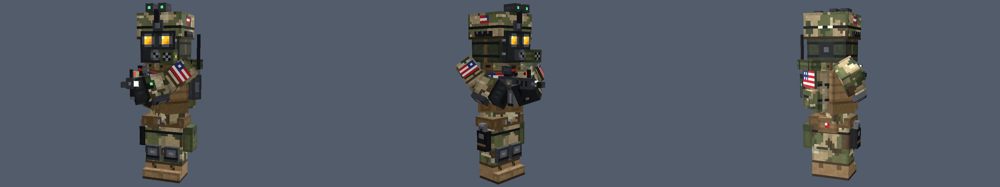
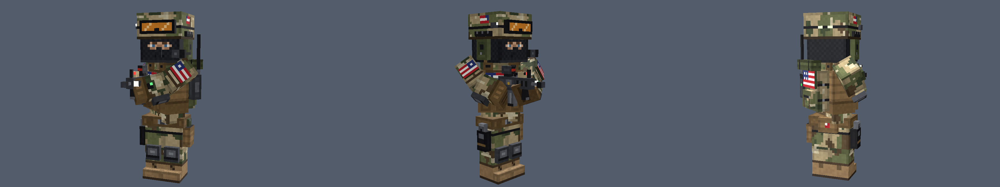

# Враги: военные США (кубический стиль, Godot 4)

Две модели в стиле Minecraft с удвоенной детализацией скина и объёмным снаряжением из кубоидов:

| Файл | Описание |
|---|---|
| `soldier_gasmask.glb` | боец в противогазе: светящиеся линзы, фильтр, откинутый ПНВ, сумка противогаза |
| `soldier_balaclava.glb` | боец в балаклаве: прорезь с глазами, очки на шлеме, наушники с микрофоном |

У обоих: камуфляж OCP, шлем, бронежилет с подсумками и магазинами, рюкзак со скаткой, рация с антенной,
наколенники и налокотники, кобура с пистолетом, карабин М4 с коллиматором, флаг США на рукавах, груди,
шлеме и рюкзаке. ~70 кубоидов, ~870 треугольников, рост ≈ 1.9 м.




## Установка

Скопируйте папку `us_soldier` в свой проект Godot 4 (например, в `res://enemies/`). `.glb` импортируется
сам: текстура зашита внутрь, фильтрация — Nearest (чёткие пиксели), свечение линз и вспышки — через emission.

Перетащите `.glb` в сцену или сделайте **New Inherited Scene**. Модель смотрит в **+Z**, ноги на `y = 0`.

## Узлы и анимации

```
Hips ─ Torso ─ Head
     │       ├ ArmL ─ ForearmL
     │       ├ ArmR ─ ForearmR
     │       └ Rifle ─ MuzzleFlash
     ├ LegL ─ ShinL
     └ LegR ─ ShinR
```

Анимации в `AnimationPlayer`: `idle` и `walk` (зациклены), `shoot` (отдача + дульная вспышка), `death`.

```gdscript
@onready var anim: AnimationPlayer = $soldier_gasmask/AnimationPlayer

func _ready() -> void:
	anim.play("walk")

func fire() -> void:
	anim.play("shoot")
	anim.queue("idle")
```

## Изменение моделей

Модели собираются скриптом `tools/generate_soldiers.py` (Python 3, без зависимостей):

```
python3 tools/generate_soldiers.py
```

Палитра, камуфляж, снаряжение, поза и анимации задаются в коде: каждый кубоид — вызов `box(...)`,
пиксели на гранях — `fill` / `px` / `sprite`.
